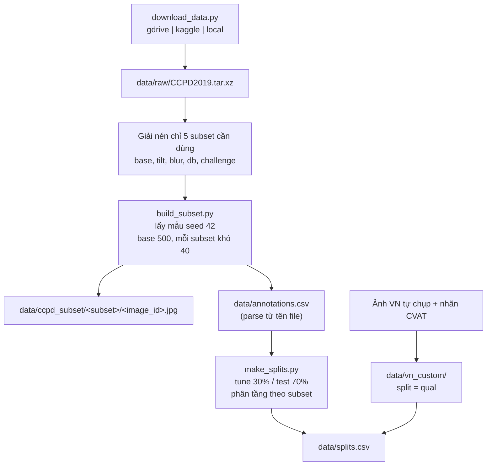
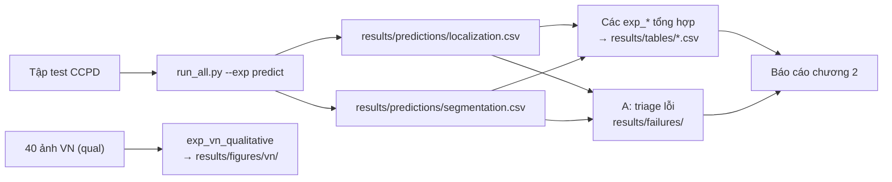
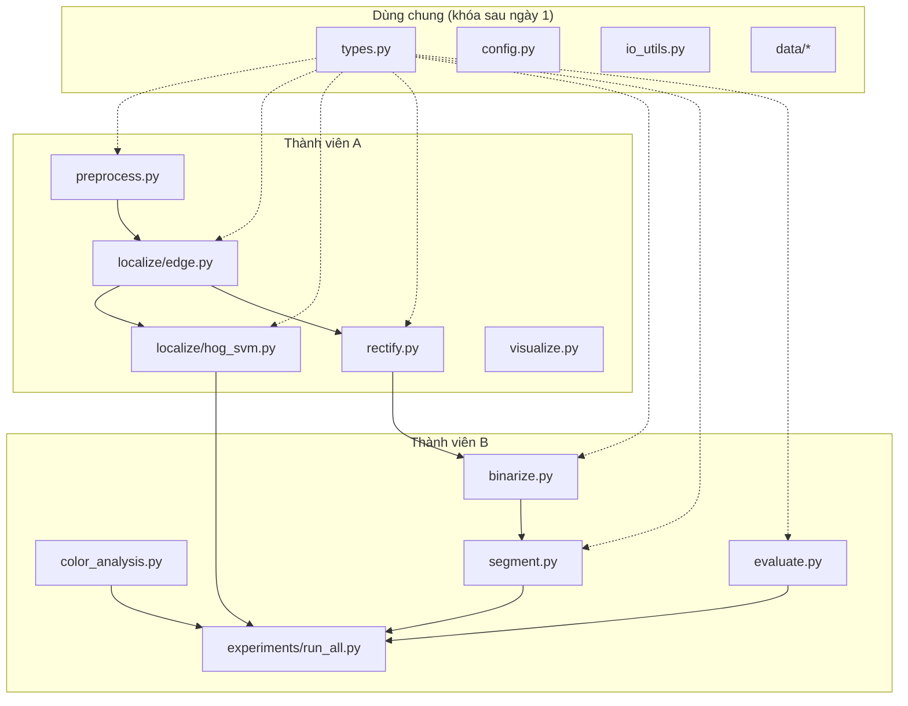
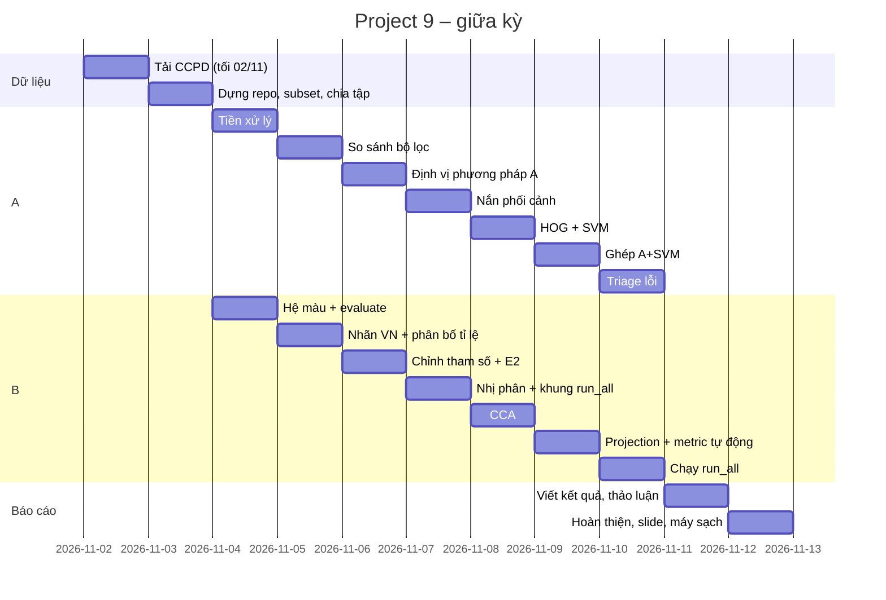

# SPEC – Project 9: License Plate Detection and Character Segmentation (giữa kỳ)

Phiên bản: 1.0 (02/11/2026) · Nhóm 2 người (A, B) · Phạm vi: kỹ thuật xử lý ảnh cổ điển, không học sâu

Tài liệu này là bản thiết kế kỹ thuật. Mọi tên hàm, chữ ký, định dạng file và metric ở đây là **hợp đồng giữa A và B**. Muốn đổi chữ ký hàm thì phải báo người kia và sửa spec trước, rồi mới sửa code.

---

## 0. Hướng dẫn cho Claude Code (dựng nền repo)

Đọc toàn bộ spec này rồi làm đúng các bước sau. Không tự thêm thư viện học sâu.

1. Tạo repo mới tên `lpr-classic` theo **mục 3 (Cấu trúc repo)**, khởi tạo git, thêm `.gitignore` (bỏ qua `data/raw/`, `data/ccpd_subset/`, `results/`, `models/`, `__pycache__/`, `.venv/`).
2. Tạo `requirements.txt`, `pyproject.toml` (package `lpr` nằm trong `src/`, cài bằng `pip install -e .`), `config/default.yaml` đúng **mục 7**.
3. **Viết đầy đủ (chạy được)** các file sau:
   - `src/lpr/types.py`, `src/lpr/config.py`, `src/lpr/io_utils.py`
   - `src/lpr/data/ccpd.py`, `src/lpr/data/dataset.py`
   - `scripts/download_data.py`, `scripts/build_subset.py`, `scripts/make_splits.py`
   - `tests/test_ccpd.py`, `tests/test_splits.py`
4. **Viết hàm rỗng (stub)** cho mọi hàm còn lại trong **mục 8**: đúng tên, đúng chữ ký, có type hint và docstring tiếng Việt mô tả input/output, thân hàm là `raise NotImplementedError("TODO(<A|B>): <tên hàm>")`. Mỗi file ghi chủ sở hữu ở dòng đầu: `# OWNER: A` hoặc `# OWNER: B`.
5. Tạo `experiments/run_all.py` có CLI và đủ các hàm `exp_*` (stub), đăng ký trong dict `EXPERIMENTS`.
6. Tạo `README.md` gồm: cài đặt, tải dữ liệu, dựng subset, chia tập, chạy test, chạy thí nghiệm, bảng phân công file.
7. Tạo `notes.md` rỗng có các mục: Tiền xử lý, Định vị, Nắn, Nhị phân, Tách ký tự, Đánh giá.
8. Tải dữ liệu và chạy theo thứ tự ở **mục 5.6**. Nếu tải Google Drive bị lỗi quota thì dừng lại, in hướng dẫn tải tay, không thử vòng lặp.
9. Kiểm tra cuối: `pytest -q` pass; `python experiments/run_all.py --list` in ra danh sách thí nghiệm; `data/annotations.csv` có đúng 660 dòng CCPD; `data/splits.csv` đúng tỉ lệ 30/70 theo từng subset.

---

## 1. Tổng quan

**Bài toán:** hệ thống kiểm soát xe ra vào bãi gửi xe. Camera cố định chụp xe. Hệ thống định vị biển số, nắn biển về hình chữ nhật chuẩn, rồi tách từng ký tự để chuẩn bị cho OCR.

**Đầu ra giữa kỳ:** với mỗi ảnh, trả về hộp biển số, ảnh biển đã nắn và danh sách hộp ký tự. OCR, YOLO và giao diện để cuối kỳ.

**Đối chiếu yêu cầu giữa kỳ:**

| Yêu cầu GV | Module | Chủ |
|---|---|---|
| 1. Biểu diễn ảnh, hệ màu | `preprocess.to_*`, `color_analysis` | A, B |
| 2. Thao tác điểm ảnh, biến đổi hình học, lọc | `preprocess`, `rectify` | A |
| 3. Hình thái học | `localize.edge`, `segment` (opening) | A, B |
| 4. Phân đoạn / đặc trưng cổ điển | `localize.edge`, `localize.hog_svm`, `segment` | A, B |

**Ngoài phạm vi giữa kỳ:** nhận dạng ký tự, mô hình học sâu, giao diện web, biển 2 dòng trong đánh giá định lượng.

---

## 2. Sơ đồ pipeline

### 2.1 Luồng xử lý một ảnh

```mermaid
flowchart LR
    IN["Ảnh xe (BGR)"] --> PRE["preprocess<br/>resize rộng 800<br/>gray + CLAHE<br/>denoise"]
    PRE --> EDGE["localize_edge<br/>Sobel-x → Otsu<br/>Close ngang → Open<br/>contour → heuristic"]
    EDGE --> CAND[("Candidates<br/>bbox + quad + score")]
    CAND -->|"Phương pháp A"| BEST["Chọn ứng viên<br/>điểm cao nhất"]
    CAND -->|"Phương pháp A+SVM"| SVM["score_candidates<br/>HOG + LinearSVC"]
    SVM --> BEST
    BEST --> RECT{"rectify"}
    RECT -->|"bbox"| CROP["crop_bbox<br/>220×70"]
    RECT -->|"quad"| WARP["warp_plate<br/>homography 220×70"]
    CROP --> BIN{"binarize_plate<br/>Otsu | Adaptive"}
    WARP --> BIN
    BIN --> POL["ensure_text_white"]
    POL --> SEG{"segment<br/>CCA | Projection"}
    SEG --> OUT["CharBoxes"]
    OUT --> VIS["visualize + evaluate"]
```



### 2.2 Chuẩn bị dữ liệu



### 2.3 Luồng thí nghiệm



### 2.4 Phụ thuộc giữa module và chủ sở hữu



---

## 3. Cấu trúc repo

```
lpr-classic/
├── README.md
├── SPEC.md                    # file này
├── notes.md                   # ghi tham số đã thử, nguồn cho phần thảo luận
├── requirements.txt
├── pyproject.toml
├── .gitignore
├── config/
│   └── default.yaml
├── data/
│   ├── raw/                   # file nén + thư mục giải nén (gitignore)
│   ├── ccpd_subset/           # 660 ảnh đã lấy mẫu (gitignore, chia sẻ qua Drive)
│   │   ├── base/ tilt/ blur/ db/ challenge/
│   ├── vn_custom/
│   │   ├── images/            # 40 ảnh tự chụp, đã làm mờ mặt
│   │   └── annotations.csv
│   ├── char_labels/
│   │   └── char_boxes.csv     # bbox ký tự gán tay cho 30 biển
│   ├── annotations.csv
│   └── splits.csv
├── scripts/
│   ├── download_data.py
│   ├── build_subset.py
│   └── make_splits.py
├── src/lpr/
│   ├── __init__.py
│   ├── types.py               # SHARED
│   ├── config.py              # SHARED
│   ├── io_utils.py            # SHARED
│   ├── data/
│   │   ├── __init__.py
│   │   ├── ccpd.py            # SHARED
│   │   └── dataset.py         # SHARED
│   ├── preprocess.py          # A
│   ├── color_analysis.py      # B
│   ├── localize/
│   │   ├── __init__.py
│   │   ├── edge.py            # A
│   │   └── hog_svm.py         # A
│   ├── rectify.py             # A
│   ├── binarize.py            # B
│   ├── segment.py             # B
│   ├── evaluate.py            # B
│   └── visualize.py           # A
├── experiments/
│   └── run_all.py             # B
├── notebooks/
│   ├── 01_color_spaces.ipynb  # B
│   └── 02_pipeline_demo.ipynb # A
├── models/                    # svm.joblib (gitignore)
├── results/                   # gitignore
│   ├── predictions/ tables/ figures/ failures/
└── tests/
    ├── test_ccpd.py
    ├── test_splits.py
    ├── test_evaluate.py       # B viết khi làm evaluate
    └── test_rectify.py        # A viết khi làm rectify
```

---

## 4. Môi trường

- Python 3.10 trở lên.
- `requirements.txt`:

```
opencv-python>=4.8
numpy>=1.24
scikit-image>=0.21
scikit-learn>=1.3
pandas>=2.0
matplotlib>=3.7
pyyaml>=6.0
joblib>=1.3
tqdm>=4.66
gdown>=5.1
pytest>=7.4
```

- Cài: `python -m venv .venv`, kích hoạt, `pip install -r requirements.txt`, `pip install -e .`
- Mọi script chạy từ thư mục gốc repo. Mọi đường dẫn đọc từ `config/default.yaml`, không hardcode.

---

## 5. Dữ liệu

### 5.1 Nguồn CCPD2019

- Repo chính thức: https://github.com/detectRecog/CCPD
- Google Drive file id: `1rdEsCUcIUaYOVRkx5IMTRNA7PcGMmSgc` (file `CCPD2019.tar.xz`, hơn 300 nghìn ảnh, dung lượng lớn).
- BaiduYun: id `1i5AOjAbtkwb17Zy-NQGqkw`, mã `hm0u` (dự phòng, tải tay).
- Các subset dùng: `ccpd_base`, `ccpd_tilt`, `ccpd_blur`, `ccpd_db`, `ccpd_challenge`.

### 5.2 Định dạng tên file CCPD

Ví dụ: `025-95_113-154&383_386&473-386&473_177&454_154&383_363&402-0_0_22_27_27_33_16-37-15.jpg`

Tách theo dấu `-` được 7 trường:

| # | Trường | Ví dụ | Ý nghĩa |
|---|---|---|---|
| 0 | area | `025` | Tỉ lệ diện tích biển / ảnh (‰) |
| 1 | tilt | `95_113` | Góc nghiêng ngang, dọc |
| 2 | bbox | `154&383_386&473` | Góc trên-trái, dưới-phải |
| 3 | vertices | `386&473_177&454_154&383_363&402` | 4 đỉnh, **bắt đầu từ dưới-phải**, theo thứ tự: dưới-phải, dưới-trái, trên-trái, trên-phải |
| 4 | plate | `0_0_22_27_27_33_16` | 7 chỉ số ký tự |
| 5 | brightness | `37` | Độ sáng |
| 6 | blur | `15` | Độ mờ |

Giải mã chuỗi biển: chỉ số 0 tra bảng `PROVINCES`, chỉ số 1 tra `ALPHABETS`, chỉ số 2–6 tra `ADS`. Giá trị `"O"` ở cuối mỗi bảng nghĩa là không có ký tự, ảnh chứa `O` bị loại khi lấy mẫu.

```python
PROVINCES = ["皖", "沪", "津", "渝", "冀", "晋", "蒙", "辽", "吉", "黑", "苏", "浙", "京", "闽", "赣", "鲁", "豫", "鄂",
             "湘", "粤", "桂", "琼", "川", "贵", "云", "藏", "陕", "甘", "青", "宁", "新", "警", "学", "O"]
ALPHABETS = ['A', 'B', 'C', 'D', 'E', 'F', 'G', 'H', 'J', 'K', 'L', 'M', 'N', 'P', 'Q', 'R', 'S', 'T', 'U', 'V', 'W',
             'X', 'Y', 'Z', 'O']
ADS = ['A', 'B', 'C', 'D', 'E', 'F', 'G', 'H', 'J', 'K', 'L', 'M', 'N', 'P', 'Q', 'R', 'S', 'T', 'U', 'V', 'W', 'X',
       'Y', 'Z', '0', '1', '2', '3', '4', '5', '6', '7', '8', '9', 'O']
```

Ví dụ trên giải mã thành `皖AY339S`. Quad trong toàn repo được lưu theo thứ tự **TL, TR, BR, BL**, nên parser phải đổi thứ tự từ (BR, BL, TL, TR) sang (TL, TR, BR, BL).

### 5.3 Lấy mẫu

| Subset | Số ảnh | Tune (30%) | Test (70%) |
|---|---|---|---|
| base | 500 | 150 | 350 |
| tilt | 40 | 12 | 28 |
| blur | 40 | 12 | 28 |
| db | 40 | 12 | 28 |
| challenge | 40 | 12 | 28 |
| **Tổng CCPD** | **660** | **198** | **462** |
| vn_custom | 40 | – | – (split `qual`) |

- Seed cố định `42`.
- Chỉ lấy ảnh có chuỗi biển hợp lệ (đủ 7 ký tự, không chứa `O`).
- Ảnh được copy và đổi tên thành `<image_id>.jpg` với `image_id = f"{subset}_{i:04d}"` để đường dẫn ngắn. Tên gốc giữ trong cột `orig_name`.

### 5.4 Ảnh VN tự chụp

- 40 ảnh, làm mờ mặt người trước khi đưa vào repo.
- Gán bbox biển bằng CVAT hoặc LabelImg, xuất về `data/vn_custom/annotations.csv` với các cột: `image_id, file, x1, y1, x2, y2, n_lines`.
- **Chỉ dùng test định tính** (split `qual`). Không dùng để chỉnh ngưỡng heuristic, không làm patch HOG, không tính vào bảng số liệu. Lý do: phần lớn là biển xe máy 2 dòng gần vuông, khác hẳn phân bố của CCPD.

### 5.5 Schema file dữ liệu

**`data/annotations.csv`** (một dòng mỗi ảnh CCPD):

| Cột | Kiểu | Ghi chú |
|---|---|---|
| image_id | str | `base_0000` |
| source | str | `ccpd` |
| subset | str | `base`, `tilt`, `blur`, `db`, `challenge` |
| file | str | đường dẫn tương đối từ gốc repo |
| orig_name | str | tên file gốc CCPD |
| x1, y1, x2, y2 | int | bbox |
| tl_x, tl_y, tr_x, tr_y, br_x, br_y, bl_x, bl_y | int | quad theo TL, TR, BR, BL |
| text | str | chuỗi biển 7 ký tự |
| n_lines | int | luôn bằng 1 với CCPD |
| area, tilt_h, tilt_v, brightness, blur | int | metadata CCPD |

**`data/splits.csv`**: `image_id, split` với `split ∈ {tune, test, qual}`.

**`data/char_labels/char_boxes.csv`**: `image_id, char_idx, x1, y1, x2, y2`. Tọa độ nằm trên **ảnh biển đã nắn bằng quad thật**, kích thước 220×70. Gán cho 30 biển thuộc tập test, mỗi người 15 biển.

### 5.6 Thứ tự lệnh dựng dữ liệu

```bash
# 1. Tải (thử Google Drive trước)
python scripts/download_data.py --source gdrive --out data/raw
#    Nếu lỗi quota: tải tay qua trình duyệt hoặc mirror, rồi:
python scripts/download_data.py --source local --archive /đường/dẫn/CCPD2019.tar.xz --out data/raw
#    Hoặc Kaggle (cần ~/.kaggle/kaggle.json):
python scripts/download_data.py --source kaggle --kaggle-slug <owner>/<dataset> --out data/raw

# 2. Lấy mẫu + parse nhãn
python scripts/build_subset.py --raw data/raw --out data/ccpd_subset --annotations data/annotations.csv

# 3. Chia tập
python scripts/make_splits.py --annotations data/annotations.csv --vn data/vn_custom/annotations.csv --out data/splits.csv

# 4. Kiểm tra
pytest -q
```

**Yêu cầu với `download_data.py`:**
- `--source gdrive` dùng `gdown` với file id ở mục 5.1. Khi `gdown` báo lỗi quota hoặc trả về trang HTML, in ra hướng dẫn tải tay kèm link và thoát mã 2. Không tự thử lại liên tục.
- `--source kaggle` gọi Kaggle API với slug do người dùng truyền vào (không hardcode slug).
- `--source local` nhận file `.tar.xz` có sẵn, hoặc thư mục đã giải nén (`--extracted`).
- Giải nén theo kiểu streaming bằng `tarfile.open(mode="r|xz")`, **chỉ trích các thư mục của 5 subset cần dùng** để tiết kiệm ổ đĩa.
- Có cờ `--subsets` (mặc định 5 subset trên) và `--skip-extract`.
- Ghi `data/raw/DOWNLOAD_INFO.txt` gồm nguồn, ngày tải, kích thước file.

---

## 6. Kiểu dữ liệu chung (`src/lpr/types.py`, SHARED)

```python
from __future__ import annotations
from dataclasses import dataclass, field
from typing import Literal
import numpy as np

BBox = tuple[int, int, int, int]          # (x1, y1, x2, y2), pixel, x2/y2 không bao gồm
Quad = np.ndarray                          # shape (4, 2), float32, thứ tự TL, TR, BR, BL
Split = Literal["tune", "test", "qual"]
DenoiseMethod = Literal["none", "gaussian", "median", "bilateral"]
BinarizeMethod = Literal["otsu", "adaptive"]
SegmentMethod = Literal["cca", "projection"]
CropMethod = Literal["bbox", "quad"]

@dataclass
class PlateRecord:
    image_id: str
    path: str
    source: Literal["ccpd", "vn"]
    subset: str
    split: Split
    bbox: BBox
    quad: Quad | None = None               # None với ảnh VN
    text: str | None = None
    n_lines: int = 1
    meta: dict = field(default_factory=dict)  # area, tilt_h, tilt_v, brightness, blur

@dataclass
class Candidate:
    bbox: BBox                             # trong tọa độ ảnh GỐC (đã nhân lại scale)
    quad: Quad                             # từ minAreaRect, TL, TR, BR, BL
    score: float                           # heuristic hoặc SVM, càng cao càng giống biển
    method: str                            # "edge" | "edge_svm"
    features: dict = field(default_factory=dict)  # aspect, area_ratio, fill_ratio, edge_density, angle

@dataclass
class CharBox:
    x1: int; y1: int; x2: int; y2: int     # trong tọa độ ảnh biển 220×70
    line: int = 0                          # 0 = dòng trên / dòng duy nhất

@dataclass
class DebugSteps:
    images: dict[str, np.ndarray] = field(default_factory=dict)  # tên bước -> ảnh, giữ thứ tự chèn
```

**Quy ước bắt buộc:**
- Ảnh màu luôn là BGR `uint8` (chuẩn OpenCV). Ảnh xám là `uint8` 2 chiều.
- Ảnh nhị phân là `uint8` với giá trị 0 và 255, **ký tự = 255**.
- Mọi hàm không được sửa ảnh đầu vào tại chỗ.
- Mọi tọa độ trả ra ngoài module localize là tọa độ ảnh gốc.

---

## 7. Cấu hình (`config/default.yaml`)

```yaml
seed: 42
paths:
  raw: data/raw
  subset: data/ccpd_subset
  annotations: data/annotations.csv
  splits: data/splits.csv
  vn: data/vn_custom/annotations.csv
  char_labels: data/char_labels/char_boxes.csv
  models: models
  results: results
data:
  subsets: {base: 500, tilt: 40, blur: 40, db: 40, challenge: 40}
  tune_ratio: 0.3
preprocess:
  resize_width: 800
  clahe: {clip_limit: 2.0, tile: [8, 8]}
  denoise: bilateral                       # none | gaussian | median | bilateral
  gaussian: {ksize: 5}
  median: {ksize: 5}
  bilateral: {d: 11, sigma_color: 17, sigma_space: 17}
localize:
  sobel_ksize: 3
  close_kernel: [21, 5]                    # rộng × cao, kernel nằm ngang
  open_kernel: [3, 3]
  aspect_range: [2.0, 6.0]                 # chốt lại sau khi B vẽ phân bố ngày 3
  area_ratio_range: [0.002, 0.10]
  min_fill_ratio: 0.4
  min_edge_density: 0.12
  max_angle: 30
  top_k: 5
hog_svm:
  patch_size: [128, 32]                    # rộng × cao
  orientations: 9
  pixels_per_cell: [8, 8]
  cells_per_block: [2, 2]
  neg_per_pos: 3
  C: 1.0
  score_threshold: 0.0
rectify:
  plate_size: [220, 70]                    # tỉ lệ 440:140 mm của biển xanh Trung Quốc
  quad_method: approxpoly                  # minarearect | approxpoly
binarize:
  method: otsu                             # otsu | adaptive
  adaptive: {block_size: 25, C: 7}
segment:
  method: cca                              # cca | projection
  char_height_range: [0.4, 0.9]            # so với chiều cao biển
  char_aspect_range: [0.10, 1.0]           # rộng / cao
  min_area: 30
  projection: {min_gap: 2, min_width: 4}
  # Vị trí khuôn ký tự (mm, biển 440×140): rộng 45, cách 12, sau ký tự thứ 2 cách 34.
  # Kiểm tra lại trên 5 ảnh thật ngày 6 rồi mới dùng chính thức.
  char_template_mm: [[15.5, 60.5], [72.5, 117.5], [151.5, 196.5], [208.5, 253.5],
                     [265.5, 310.5], [322.5, 367.5], [379.5, 424.5]]
evaluate:
  iou_threshold: 0.5
  char_iou_threshold: 0.5
  char_center_max_width_ratio: 0.6         # luật tâm hộp hẹp, SPEC 9.3
```

Tham số `localize` đã chỉnh trên tập tune, chi tiết ở `notes.md`.

`config.py` có `load_config(path: str = "config/default.yaml", overrides: dict | None = None) -> dict` (merge sâu `overrides` vào config) và `get(cfg: dict, dotted_key: str, default=None)`.

---

## 8. API từng module

Chữ ký dưới đây là bắt buộc. Thân hàm có thể thêm hàm phụ có tiền tố `_` tùy ý.

### 8.1 `io_utils.py` (SHARED, viết đủ lúc dựng nền)

```python
def read_image(path: str) -> np.ndarray: ...            # dùng np.fromfile + cv2.imdecode để đọc được đường dẫn Unicode
def write_image(path: str, img: np.ndarray) -> None: ... # tự tạo thư mục cha, dùng cv2.imencode + tofile
def ensure_dir(path: str) -> str: ...
def write_csv(rows: list[dict], path: str) -> None: ...
def timer() -> "Timer": ...                              # context manager, thuộc tính .ms
```

### 8.2 `data/ccpd.py` (SHARED, viết đủ)

```python
PROVINCES: list[str]; ALPHABETS: list[str]; ADS: list[str]

def decode_plate(indices: list[int]) -> str | None: ...  # None nếu có "O" hoặc sai độ dài
def parse_ccpd_filename(name: str) -> dict: ...
    # trả về {bbox, quad (TL,TR,BR,BL, np.float32), text, area, tilt_h, tilt_v, brightness, blur}
    # raise ValueError nếu tên file sai định dạng
def list_subset_files(raw_root: str, subset: str) -> list[str]: ...
```

### 8.3 `data/dataset.py` (SHARED, viết đủ)

```python
def load_annotations(cfg: dict) -> pd.DataFrame: ...       # gộp annotations.csv + splits.csv
def load_records(cfg: dict, split: Split | None = None,
                 subsets: list[str] | None = None) -> list[PlateRecord]: ...
def load_vn_records(cfg: dict) -> list[PlateRecord]: ...   # split = "qual"
def load_char_labels(cfg: dict) -> dict[str, list[CharBox]]: ...
```

### 8.4 `preprocess.py` (A)

```python
def resize_keep_width(img: np.ndarray, width: int) -> tuple[np.ndarray, float]: ...  # trả về (ảnh, scale = mới/cũ)
def to_gray(img: np.ndarray) -> np.ndarray: ...
def to_hsv(img: np.ndarray) -> np.ndarray: ...
def to_lab(img: np.ndarray) -> np.ndarray: ...
def get_channel(img: np.ndarray, name: str) -> np.ndarray: ...  # name ∈ gray,H,S,V,L,a,b
def apply_clahe(gray: np.ndarray, clip_limit: float, tile: tuple[int, int]) -> np.ndarray: ...
def denoise(gray: np.ndarray, method: DenoiseMethod, params: dict) -> np.ndarray: ...
def blackhat(gray: np.ndarray, kernel: tuple[int, int]) -> np.ndarray: ...
def preprocess(img: np.ndarray, cfg: dict) -> tuple[np.ndarray, float, DebugSteps]: ...
    # pipeline đầy đủ theo cfg["preprocess"], trả về (gray đã xử lý, scale, debug)
```

### 8.5 `color_analysis.py` (B)

```python
def plate_mask(shape: tuple[int, int], bbox: BBox) -> np.ndarray: ...
def channel_histograms(img: np.ndarray, bbox: BBox, channels: list[str],
                       bins: int = 64) -> dict[str, tuple[np.ndarray, np.ndarray]]: ...
    # mỗi kênh -> (hist trong biển, hist ngoài biển), đã chuẩn hóa tổng = 1
def separability(h_in: np.ndarray, h_out: np.ndarray) -> float: ...  # khoảng cách Bhattacharyya
def channel_ranking(records: list[PlateRecord], channels: list[str]) -> pd.DataFrame: ...
    # cột: channel, mean_separability, std; sắp giảm dần
```

### 8.6 `localize/edge.py` (A) – Phương pháp A

```python
def sobel_x_map(gray: np.ndarray, ksize: int) -> np.ndarray: ...       # |Sobel-x| chuẩn hóa về uint8
def binarize_edges(edge: np.ndarray) -> np.ndarray: ...                # Otsu
def morph_plate_regions(binary: np.ndarray, close_k: tuple[int, int],
                        open_k: tuple[int, int]) -> np.ndarray: ...
def extract_regions(mask: np.ndarray) -> list[tuple]: ...              # list cv2.minAreaRect
def candidate_features(rect: tuple, img_shape: tuple[int, int],
                       edge: np.ndarray, mask: np.ndarray) -> dict: ...
    # aspect, area_ratio, fill_ratio, edge_density, angle
def filter_candidates(rects: list[tuple], img_shape: tuple[int, int], edge: np.ndarray,
                      mask: np.ndarray, cfg: dict) -> list[Candidate]: ...
    # lọc theo ngưỡng cfg["localize"], tính score heuristic, sắp giảm dần, giữ top_k
def localize_edge(img: np.ndarray, cfg: dict,
                  return_debug: bool = False) -> list[Candidate] | tuple[list[Candidate], DebugSteps]: ...
    # tọa độ trả về theo ảnh gốc
```

### 8.7 `localize/hog_svm.py` (A) – Phương pháp A+SVM

```python
def extract_hog(patch: np.ndarray, cfg: dict) -> np.ndarray: ...        # patch gray, resize về patch_size
def build_patch_dataset(records: list[PlateRecord], cfg: dict) -> tuple[np.ndarray, np.ndarray]: ...
    # dương: crop bbox thật; âm: ứng viên sai của localize_edge (IoU < 0.3) + vùng ngẫu nhiên; chỉ dùng split tune
def train_svm(X: np.ndarray, y: np.ndarray, cfg: dict) -> tuple["LinearSVC", dict]: ...  # trả về (model, kết quả CV 5 fold)
def save_model(model, path: str) -> None: ...
def load_model(path: str): ...
def score_candidates(img: np.ndarray, candidates: list[Candidate], model, cfg: dict) -> list[Candidate]: ...
    # score = decision_function; sắp giảm dần; method = "edge_svm"
def localize_edge_svm(img: np.ndarray, model, cfg: dict) -> list[Candidate]: ...
```

### 8.8 `rectify.py` (A)

```python
def order_quad(pts: np.ndarray) -> Quad: ...                             # sắp 4 điểm bất kỳ về TL, TR, BR, BL
def quad_from_candidate(img: np.ndarray, cand: Candidate, method: str) -> Quad: ...  # minarearect | approxpoly
def crop_bbox(img: np.ndarray, bbox: BBox, size: tuple[int, int]) -> np.ndarray: ...
def warp_plate(img: np.ndarray, quad: Quad, size: tuple[int, int]) -> np.ndarray: ...
def rectify(img: np.ndarray, bbox: BBox, quad: Quad | None, method: CropMethod,
            cfg: dict) -> np.ndarray: ...                                # trả về ảnh BGR 220×70
def corner_error(pred: Quad, gt: Quad) -> float: ...                     # trung bình khoảng cách 4 góc (pixel)
```

### 8.9 `binarize.py` (B)

```python
def binarize_plate(plate_gray: np.ndarray, method: BinarizeMethod, params: dict) -> np.ndarray: ...
def ensure_text_white(binary: np.ndarray) -> np.ndarray: ...
    # biển xanh CCPD có chữ trắng, biển vàng có chữ đen: đảo nếu tỉ lệ pixel trắng > 0.5
def clean_binary(binary: np.ndarray, open_k: tuple[int, int] = (2, 2)) -> np.ndarray: ...
```

### 8.10 `segment.py` (B)

```python
def split_lines(binary: np.ndarray) -> list[tuple[int, int]]: ...        # chiếu ngang, trả về các khoảng (y0, y1)
def segment_cca(binary: np.ndarray, cfg: dict) -> list[CharBox]: ...
def segment_projection(binary: np.ndarray, cfg: dict) -> list[CharBox]: ...
def merge_split_boxes(boxes: list[CharBox], plate_w: int, plate_h: int) -> list[CharBox]: ...
    # gộp mảnh nhỏ sát nhau (ký tự Hán vỡ nét), cắt đôi hộp rộng gấp ~2 trung vị
def segment(binary: np.ndarray, method: SegmentMethod, cfg: dict) -> list[CharBox]: ...  # sắp trái → phải
```

### 8.11 `evaluate.py` (B)

```python
def iou(a: BBox, b: BBox) -> float: ...
def match_detections(preds: list[BBox], gts: list[BBox], thr: float) -> tuple[int, int, int]: ...  # TP, FP, FN
def prf(tp: int, fp: int, fn: int) -> dict: ...                         # precision, recall, f1
def iou_1d(a: tuple[float, float], b: tuple[float, float]) -> float: ...
def template_intervals(cfg: dict) -> list[tuple[float, float]]: ...     # đổi char_template_mm sang pixel theo plate_size
def position_hits(boxes: list[CharBox], cfg: dict) -> list[bool]: ...   # 7 phần tử, xem mục 9.3
def count_match(boxes: list[CharBox], text: str) -> bool: ...
def char_box_prf(pred: list[CharBox], gt: list[CharBox], thr: float) -> dict: ...
```

### 8.12 `visualize.py` (A)

```python
def draw_candidates(img: np.ndarray, cands: list[Candidate], gt: BBox | None = None) -> np.ndarray: ...
def draw_char_boxes(plate: np.ndarray, boxes: list[CharBox]) -> np.ndarray: ...
def save_debug_grid(debug: DebugSteps, path: str, cols: int = 3) -> None: ...
def save_comparison(images: dict[str, np.ndarray], path: str) -> None: ...  # nhiều ảnh cạnh nhau, có tiêu đề
```

### 8.13 `experiments/run_all.py` (B)

```python
EXPERIMENTS: dict[str, Callable[[dict, argparse.Namespace], None]]

def exp_predict(cfg, args) -> None: ...          # E0: chạy pipeline trên test, ghi 2 file predictions
def exp_color(cfg, args) -> None: ...            # E1
def exp_filters(cfg, args) -> None: ...          # E2
def exp_localization(cfg, args) -> None: ...     # E3
def exp_rectify(cfg, args) -> None: ...          # E4
def exp_binarize(cfg, args) -> None: ...         # E5
def exp_segmentation(cfg, args) -> None: ...     # E6
def exp_runtime(cfg, args) -> None: ...          # E7
def exp_vn_qualitative(cfg, args) -> None: ...   # E8
def main() -> None: ...
```

CLI: `python experiments/run_all.py --exp <tên>|all [--split test] [--limit N] [--config config/default.yaml] [--list]`. Cờ `--limit` để chạy thử nhanh trên N ảnh.

---

## 9. Định nghĩa metric

### 9.1 Định vị
- Mỗi ảnh có đúng 1 biển. Lấy ứng viên điểm cao nhất (top-1) làm dự đoán.
- TP nếu IoU(top-1, bbox thật) ≥ 0.5. FP nếu có dự đoán nhưng IoU < 0.5. FN nếu IoU < 0.5 hoặc không có ứng viên nào.
- Precision = TP / (TP + FP), Recall = TP / (TP + FN), F1 = 2PR / (P + R).
- Báo thêm **Recall@k** (bbox thật nằm trong top-k ứng viên) để phân biệt lỗi "không sinh ra ứng viên" với lỗi "xếp hạng sai".

### 9.2 Nắn biển
- `corner_error`: trung bình khoảng cách Euclid 4 góc giữa quad dự đoán và quad thật (pixel ảnh gốc), chỉ tính trên ảnh định vị đúng.

### 9.3 Tách ký tự (tự động trên toàn bộ tập test)
- **count_match**: số hộp ký tự = độ dài chuỗi biển (7).
- **position_hits**: biển CCPD có bố cục chuẩn, nên trên ảnh nắn 220×70, ký tự thứ *i* nằm trong một khoảng ngang cố định (`char_template_mm` × 0.5). Vị trí *i* đúng nếu tồn tại một hộp thoả một trong hai: (a) IoU theo trục x ≥ 0.5 với khoảng đó; (b) hộp hẹp (rộng > 0 và ≤ 0.6 × rộng khuôn, `evaluate.char_center_max_width_ratio`) có tâm x nằm trong khoảng [x1, x2) của khuôn. Luật (b) chỉ áp dụng cho hộp hẹp để ký tự mảnh như số "1" (~9 px, khuôn rộng 22.5 px, IoU ≈ 0.4) vẫn trúng khi nằm đúng giữa khuôn; hộp có độ rộng bình thường vẫn phải đạt IoU theo (a). Khối dính nhiều ký tự bị loại bởi luật (a) (IoU thấp).
- **pos0_acc**: tỉ lệ biển đúng vị trí 0 (ký tự Hán, dễ vỡ nét).
- **pos1_6_acc**: tỉ lệ vị trí đúng trung bình trên 6 ký tự sau.
- **all_correct**: count_match và đúng cả 7 vị trí.

### 9.4 Tách ký tự (gán tay, 30 biển)
- Khớp hộp dự đoán với hộp gán tay theo IoU ≥ 0.5, tính Precision, Recall, F1 theo hộp.

### 9.5 Tách nguồn lỗi
Mọi metric 9.3 được báo theo cột `crop_source`:
- `gt`: crop từ bbox/quad thật (cô lập lỗi tách ký tự).
- `pred`: crop từ ứng viên top-1 của phương pháp tốt nhất (lỗi tổng thể).

Chênh lệch giữa hai cột là phần lỗi do định vị gây ra.

---

## 10. Thí nghiệm

| ID | Tên | Biến thay đổi | Cố định | Metric | Output |
|---|---|---|---|---|---|
| E1 | Hệ màu | kênh gray, H, S, V, L, a, b | – | separability | `tables/e1_color.csv`, `figures/e1_hist.png` |
| E2 | Bộ lọc | denoise ∈ {none, gaussian, median, bilateral} | localize_edge | P/R/F1, ms/ảnh | `tables/e2_filters.csv` |
| E3 | Định vị | edge vs edge_svm | denoise tốt nhất từ E2 | P/R/F1, Recall@k theo subset | `tables/e3_localization.csv` |
| E4 | Nắn | crop bbox vs warp quad | binarize Otsu, CCA | corner_error, count_match, pos acc | `tables/e4_rectify.csv` |
| E5 | Nhị phân | otsu vs adaptive | crop gt, CCA | count_match, pos acc | `tables/e5_binarize.csv` |
| E6 | Tách ký tự | cca vs projection × crop_source gt/pred | binarize tốt nhất | 9.3 + 9.4 | `tables/e6_segmentation.csv` |
| E7 | Thời gian | từng bước | – | ms/ảnh (trung bình, p95) | `tables/e7_runtime.csv` |
| E8 | VN định tính | – | pipeline tốt nhất | ảnh minh họa | `figures/vn/*.png` |

Mọi bảng đều có thêm dòng chia theo `subset`.

### 10.1 Schema `results/predictions/localization.csv`

`image_id, subset, method, denoise, rank, x1, y1, x2, y2, score, iou, is_tp, ms`

### 10.2 Schema `results/predictions/segmentation.csv`

`image_id, subset, crop_source, crop_method, binarize, segmenter, n_boxes, n_expected, count_match, pos0_hit, pos1_6_hits, all_correct, ms`

Hai file này phải xuất **trước trưa ngày 8** để A làm triage lỗi.

---

## 11. Phân quyền và quy ước làm việc

| File | Chủ | Ngày làm |
|---|---|---|
| types, config, io_utils, data/* | SHARED (Claude Code dựng) | 1 |
| preprocess.py | A | 2 |
| color_analysis.py, notebook 01 | B | 2 |
| evaluate.py | B | 2 |
| localize/edge.py | A | 4 |
| rectify.py | A | 5 |
| binarize.py | B | 5 |
| run_all.py (khung) | B | 5 |
| localize/hog_svm.py | A | 6 |
| segment.py | B | 6–7 |
| visualize.py | A | dần dần |

- Chỉ sửa file mình sở hữu. Cần đổi file SHARED hoặc file của người kia thì mở issue hoặc nhắn trước.
- Nhánh git: `a/<tên-việc>`, `b/<tên-việc>`, merge vào `main` khi chạy được trên 5 ảnh và `pytest` pass.
- Commit message: `rectify: nắn biển bằng homography`.
- Mọi tham số đã thử ghi vào `notes.md` kèm kết quả.

---

## 12. Kiểm thử

| Test | Nội dung |
|---|---|
| test_ccpd | Tên file ví dụ ở mục 5.2 cho ra bbox `(154, 383, 386, 473)`, text `皖AY339S`, quad TL = `(154, 383)`, TR = `(363, 402)`, BR = `(386, 473)`, BL = `(177, 454)`; tên sai định dạng raise ValueError |
| test_splits | 660 dòng CCPD; mỗi subset tỉ lệ tune xấp xỉ 30%; không image_id nào nằm ở 2 split; ảnh VN đều là `qual` |
| test_evaluate | IoU hai hộp trùng = 1, rời = 0; prf với số liệu tay |
| test_rectify | order_quad đúng với 4 điểm bị xáo trộn |

---

## 13. Lịch (tóm tắt)



---

## 14. Rủi ro và giới hạn đã biết

| Rủi ro | Ảnh hưởng | Cách xử lý |
|---|---|---|
| Google Drive báo lỗi quota khi tải CCPD | Không có dữ liệu ngày 1 | Tải từ tối 02/11, có Kaggle/BaiduYun/tải tay dự phòng |
| Homography từ minAreaRect chỉ là chữ nhật xoay | Có thể không thắng crop bbox | Vẫn báo cáo, phân tích lý do; thử thêm approxPolyDP |
| Ký tự Hán vỡ nét khi CCA | count_match thấp | merge_split_boxes; báo cáo pos0 riêng |
| Khuôn vị trí ký tự lệch với ảnh thực | position_hits sai | Kiểm tra trên 5 ảnh ngày 6, chỉnh `char_template_mm` |
| Ảnh VN 2 dòng khác phân bố | Không đánh giá định lượng được | Chỉ test định tính, ghi vào phần hạn chế |
| Biển xanh chữ trắng và biển vàng chữ đen | Đảo cực sai | `ensure_text_white` |
